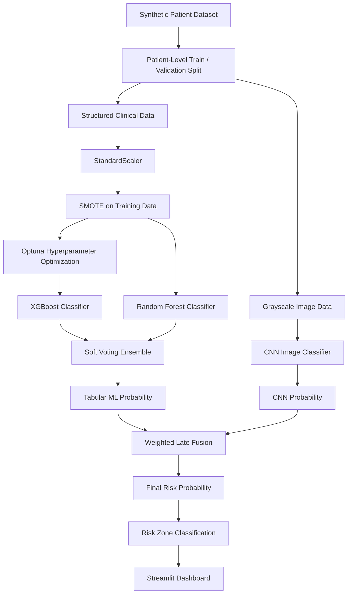

# OptiMed-Fusion
[](https://optimed-fusion-cdebz6a8ijihfkqxjpeptk.streamlit.app/)

🚀 **Live Application:** https://optimed-fusion-cdebz6a8ijihfkqxjpeptk.streamlit.app/
### Multimodal Clinical Risk Prediction Using Ensemble Machine Learning, CNNs & Late Fusion

[](https://www.python.org/)
[](https://www.tensorflow.org/)
[](https://scikit-learn.org/)
[](https://xgboost.readthedocs.io/)
[](https://streamlit.io/)
[]()

**OptiMed-Fusion** is a multimodal machine learning research prototype that combines structured clinical data and grayscale medical-style images to estimate patient risk.

The system integrates an Optuna-optimized XGBoost classifier, a Random Forest model, a CNN-based image classifier, and a weighted late-fusion mechanism. An interactive Streamlit dashboard provides patient-level inference, component-level probability analysis, and model insights.

> **Important:** This project uses entirely synthetic data and is intended for educational and research purposes. It is not a clinically validated diagnostic system and must not be used for medical diagnosis or treatment decisions.

---

## 1. Problem Statement

Clinical risk prediction can involve multiple data modalities:

- **Structured data:** Age, blood pressure, glucose, cholesterol, and other numerical biomarkers.
- **Image data:** Medical images containing spatial patterns that may provide complementary information.

A model trained on only one modality may not capture information represented in another.

OptiMed-Fusion explores a multimodal learning approach in which structured clinical features and image representations are processed through separate modeling pipelines before their predictions are combined.

### Core objectives

- Build an end-to-end multimodal prediction pipeline.
- Compare and combine multiple machine learning classifiers.
- Optimize XGBoost hyperparameters using Bayesian optimization.
- Handle class imbalance using SMOTE.
- Train an independent CNN for image-based prediction.
- Integrate modality-specific probabilities through late fusion.
- Provide an interactive inference interface.
- Validate the complete prediction pipeline through automated tests.

---

## 2. System Architecture



### High-level workflow

| Component | Responsibility |
|---|---|
| Data generation | Creates synthetic paired patient records and images |
| Data preprocessing | Handles feature scaling and image preparation |
| Optuna | Searches for promising XGBoost hyperparameters |
| XGBoost | Learns structured feature relationships |
| Random Forest | Provides an additional tree-based prediction |
| Soft Voting | Combines tabular model probabilities |
| CNN | Learns spatial patterns from grayscale images |
| Late Fusion | Combines tabular and image predictions |
| Streamlit | Provides interactive inference and visualization |

---

## 3. Dataset & Data Engineering

The prototype uses a synthetic dataset containing **1,500 paired patient samples**.

### Dataset composition

| Property | Value |
|---|---:|
| Total samples | 1,500 |
| Healthy class | 1,200 |
| High-risk class | 300 |
| Number of tabular features | 6 |
| Image dimensions | 32 × 32 × 1 |
| Image format | Grayscale |
| Target classes | 2 |

### Class distribution

- Healthy: 80%
- High-Risk: 20%

### Structured clinical features

| Feature | Description |
|---|---|
| `age` | Patient age |
| `systolic_bp` | Systolic blood pressure |
| `diastolic_bp` | Diastolic blood pressure |
| `glucose` | Glucose measurement |
| `cholesterol` | Cholesterol measurement |
| `biomarker_score` | Synthetic biomarker measurement |

Each structured patient record is paired with a corresponding grayscale image.

### Train-validation split

A stratified 80:20 split is performed before scaling and resampling.

| Split | Total | Healthy | High-Risk |
|---|---:|---:|---:|
| Training | 1,200 | 960 | 240 |
| Validation | 300 | 240 | 60 |

Patient identifiers are synchronized across modalities to preserve patient-level pairing and prevent overlap between the training and validation partitions.

### Important preprocessing decisions

- Stratified splitting preserves the original class distribution.
- StandardScaler is fitted on training data only.
- SMOTE is applied exclusively to training data.
- Validation data remains untouched by oversampling.
- Cross-validation preprocessing is performed inside each fold.

These decisions help reduce data leakage during model development.

---

## 4. Tabular Machine Learning Pipeline

The structured-data pipeline combines two tree-based classifiers.

### 4.1 Feature Scaling

`StandardScaler` standardizes the six numerical clinical features.

For a feature \(x\):

\[
z = \frac{x-\mu}{\sigma}
\]

Here, \(\mu\) and \(\sigma\) are estimated from the training partition.

The fitted scaler is reused during inference.

### 4.2 Class Imbalance Handling — SMOTE

The original dataset has an 80:20 class distribution.

SMOTE (Synthetic Minority Over-sampling Technique) generates synthetic minority-class samples by interpolating between neighboring minority observations.

\[
x_{new}=x_i+\lambda(x_{nn}-x_i)
\]

Where:

- \(x_i\) is a minority-class sample.
- \(x_{nn}\) is one of its minority-class neighbors.
- \(\lambda\) is a random interpolation coefficient.

SMOTE is applied only to training data.

For Optuna cross-validation, preprocessing and SMOTE are included inside an imbalanced-learn pipeline so that each fold learns its transformations only from that fold's training partition.

### 4.3 Optuna-Based XGBoost Optimization

XGBoost is optimized using Optuna's Tree-structured Parzen Estimator (TPE) sampler.

The optimization objective is ROC-AUC under five-fold stratified cross-validation.

The search space includes:

| Hyperparameter | Purpose |
|---|---|
| `n_estimators` | Number of boosting trees |
| `max_depth` | Maximum tree depth |
| `learning_rate` | Boosting step size |
| `subsample` | Fraction of samples used per boosting iteration |

The objective can be expressed as:

\[
\theta^*=\arg\max_{\theta}
\frac{1}{K}\sum_{k=1}^{K}
ROC\text{-}AUC_k(\theta)
\]

Where \(K=5\) and \(\theta\) represents the hyperparameter configuration.

The best configuration is used to train the final XGBoost model on the complete resampled training partition.

### 4.4 Random Forest

A Random Forest classifier is independently trained on the same resampled training data.

Random Forest combines predictions from multiple decision trees, reducing the variance associated with an individual tree.

### 4.5 Soft Voting Ensemble

Instead of combining hard class labels, the two classifiers contribute their predicted probabilities.

\[
P_{ML}=
\frac{P_{XGBoost}+P_{RF}}{2}
\]

This produces the tabular ensemble probability used by the multimodal fusion stage.

---

## 5. CNN-Based Image Classification

The image branch independently processes grayscale images of shape:

\[
32\times32\times1
\]

The CNN learns spatial representations from the image modality.

### CNN architecture

| Layer | Configuration | Purpose |
|---|---|---|
| Input | 32 × 32 × 1 | Grayscale image |
| Conv2D | 32 filters | Initial spatial feature extraction |
| Batch Normalization | — | Stabilizes activations |
| ReLU | — | Non-linear transformation |
| MaxPooling2D | — | Spatial downsampling |
| Conv2D | 64 filters | Deeper feature extraction |
| Batch Normalization | — | Normalization |
| ReLU | — | Non-linearity |
| AveragePooling2D | — | Feature-map reduction |
| Flatten | — | Converts feature maps into a vector |
| Dropout | 0.35 | Regularization |
| Dense | 64, ReLU | Feature learning |
| Output | 1, Sigmoid | Binary probability |

### Training configuration

- Optimizer: Adam
- Loss: Binary Cross-Entropy
- Output activation: Sigmoid
- Early stopping: Enabled
- Learning-rate reduction: Enabled

The CNN produces an independent probability:

\[
P_{CNN}\in[0,1]
\]

The image model is loaded independently from the structured-data classifiers during inference.

---

## 6. Multimodal Late Fusion

The central component of OptiMed-Fusion is its weighted late-fusion mechanism.

Rather than merging raw features from different modalities, the system first trains separate modality-specific models and combines their output probabilities.

### Fusion equation

\[
\boxed{
P_{final}=0.65P_{ML}+0.35P_{CNN}
}
\]

Where:

- \(P_{ML}\): Soft-voting probability from XGBoost and Random Forest.
- \(P_{CNN}\): Probability from the CNN image classifier.
- \(0.65\): Tabular modality weight.
- \(0.35\): Image modality weight.

The weights are fixed configuration values in this prototype, not learned or clinically calibrated parameters.

### Why late fusion?

- Each modality has its own learning architecture.
- Tabular and image features can be processed independently.
- Modality-specific predictions remain inspectable.
- The final probability combines information from both branches.
- Individual model components can be evaluated separately.

---

## 7. Risk Zone Classification

The final probability is mapped to one of three demonstration categories.

| Final Probability | Risk Zone |
|---|---|
| Below 0.40 | Low Risk |
| 0.40–0.60 | Borderline – Specialist Review |
| Above 0.60 | High Risk |

These are prototype-specific thresholds, not medically established clinical decision boundaries.

---

## 8. Evaluation Methodology

The project evaluates individual models and the final fusion system using standard binary-classification metrics.

### Evaluation metrics

**Accuracy**

\[
Accuracy=\frac{TP+TN}{TP+TN+FP+FN}
\]

**Precision**

\[
Precision=\frac{TP}{TP+FP}
\]

**Recall**

\[
Recall=\frac{TP}{TP+FN}
\]

**F1-score**

\[
F1=2\cdot
\frac{Precision\cdot Recall}
{Precision+Recall}
\]

**ROC-AUC**

Measures the model's ability to rank positive examples above negative examples across classification thresholds.

### Evaluation outputs

- Accuracy
- Precision
- Recall
- F1-score
- ROC-AUC
- Classification report
- Confusion matrix
- Model-level probability outputs
- Final fusion probability

No benchmark values are claimed here. Actual evaluation results should be reported alongside the exact dataset split and experimental configuration used to obtain them.

---

## 9. Interactive Streamlit Dashboard

The project includes a multi-page Streamlit application for interactive model inference and analysis.

### Dashboard modules

1. **Overview** — Project summary and system information.
2. **Patient Assessment** — Clinical feature inputs and grayscale image upload.
3. **Fusion Analysis** — Individual model probabilities and final fusion output.
4. **Model Insights** — Model performance information and visualizations when corresponding report artifacts are available.
5. **About Project** — Architecture, methodology, and research limitations.

### Inference workflow

1. Enter the six structured clinical measurements.
2. Upload a grayscale image.
3. Preprocess the image to the expected input dimensions.
4. Load the trained model artifacts.
5. Generate XGBoost, Random Forest, and CNN probabilities.
6. Calculate the soft-voting tabular probability.
7. Apply weighted late fusion.
8. Display the final probability and demonstration risk category.

The prediction pipeline is separated from the Streamlit interface to improve modularity and maintainability.

---

## 10. Technology Stack

| Category | Technologies |
|---|---|
| Language | Python |
| Data Processing | NumPy, Pandas |
| Machine Learning | Scikit-learn |
| Gradient Boosting | XGBoost |
| Imbalance Handling | imbalanced-learn, SMOTE |
| Hyperparameter Optimization | Optuna |
| Deep Learning | TensorFlow, Keras |
| Image Processing | Pillow |
| Model Serialization | Joblib, Keras, XGBoost JSON |
| Dashboard | Streamlit |
| Visualization | Plotly |
| Testing | Python unittest |
| Version Control | Git, GitHub |

---

## 11. Project Structure

```text
OptiMed-Fusion/
│
├── .streamlit/
│   └── config.toml
│
├── data/
│   ├── raw/
│   └── processed/
│
├── models/
│   ├── cnn_model.keras
│   ├── optimized_xgboost.json
│   ├── random_forest.pkl
│   ├── tabular_scaler.pkl
│   └── fusion_config.json
│
├── reports/
│   └── figures/
│
├── src/
│   ├── data_generation.py
│   ├── image_preprocessing.py
│   └── predict.py
│
├── tests/
│   └── test_prediction.py
│
├── app.py
├── requirements.txt
├── .gitignore
└── README.md
```

Generated datasets and local validation files are excluded from version control. The trained inference artifacts required by the application are included.

---

## 12. Installation & Local Execution

### Prerequisites

- Python 3.13
- Git
- pip

### Clone the repository

```bash
git clone https://github.com/Pranav123221/OptiMed-Fusion.git
cd OptiMed-Fusion
```

### Create a virtual environment

**Windows:**

```powershell
python -m venv .venv
.venv\Scripts\activate
```

**Linux / macOS:**

```bash
python -m venv .venv
source .venv/bin/activate
```

### Install dependencies

```bash
pip install -r requirements.txt
```

### Run the application

```bash
streamlit run app.py
```

The dashboard will be available at:

```text
http://localhost:8501
```

---

## 13. Testing

The project includes automated tests for the prediction pipeline.

Run:

```bash
python -m unittest discover -s tests -v
```

The test suite checks:

- Clinical feature configuration.
- Fusion-weight consistency.
- Prediction output structure.
- Probability value ranges.
- Invalid image dimensions.
- Missing clinical feature values.

Run a syntax compilation check:

```bash
python -m compileall -q app.py src tests
```

The inference pipeline has also been tested locally using the saved model artifacts.

---

## 14. Engineering Considerations

Several implementation decisions are important to the reliability of this prototype.

**Data leakage prevention**

The scaler is fitted on training data, SMOTE is restricted to training data, and the cross-validation pipeline performs preprocessing within each fold.

**Modular inference**

Model loading and prediction logic are separated from the dashboard. This makes the prediction module easier to test and reuse.

**Model artifact compatibility**

The XGBoost model is stored in its native JSON format, while the CNN and other fitted objects use their respective serialization formats.

**Reproducibility**

The repository includes dependency specifications, model artifacts, source modules, and automated tests. Exact reproduction of training experiments additionally requires the training data, random seeds, and full training configuration.

---

## 15. Limitations & Future Improvements

### Current limitations

- The dataset is synthetic and does not represent real patient populations.
- The grayscale images are synthetic and are not validated medical scans.
- The fusion weights are fixed rather than learned.
- The risk thresholds are illustrative, not clinically calibrated.
- Validation performance on synthetic data does not establish real-world generalization.
- The current validation workflow is not a substitute for an untouched external test set.

### Future improvements

- Evaluate on appropriately governed, real-world de-identified datasets.
- Establish patient-level external validation.
- Perform probability calibration and learn fusion weights using a separate training/validation strategy.
- Investigate feature-level and attention-based multimodal fusion.
- Add explainability using SHAP and Grad-CAM.
- Perform subgroup and robustness analysis.
- Add model monitoring, versioning, and reproducible experiment tracking.
- Introduce secure API-based inference and production-grade deployment controls.

---

## 16. Responsible AI & Disclaimer

OptiMed-Fusion is an educational multimodal ML research prototype.

It does not provide medical advice, diagnosis, prognosis, or treatment recommendations. Its outputs are generated from synthetic data and must not be interpreted as actual clinical risk assessments.

Any future clinical application would require appropriate real-world datasets, clinical validation, privacy and security safeguards, regulatory review, and qualified medical oversight.

---

## 17. Author

**Pranav Sharma**

B.Tech — Computer Science and Engineering (AI & ML)

- GitHub: [Pranav123221](https://github.com/Pranav123221)
- LinkedIn: [Pranav Sharma](https://www.linkedin.com/in/pranav-sharma-333b67338/)

---

**OptiMed-Fusion — Exploring multimodal learning through ensemble machine learning, deep learning, and probability-level fusion.**
